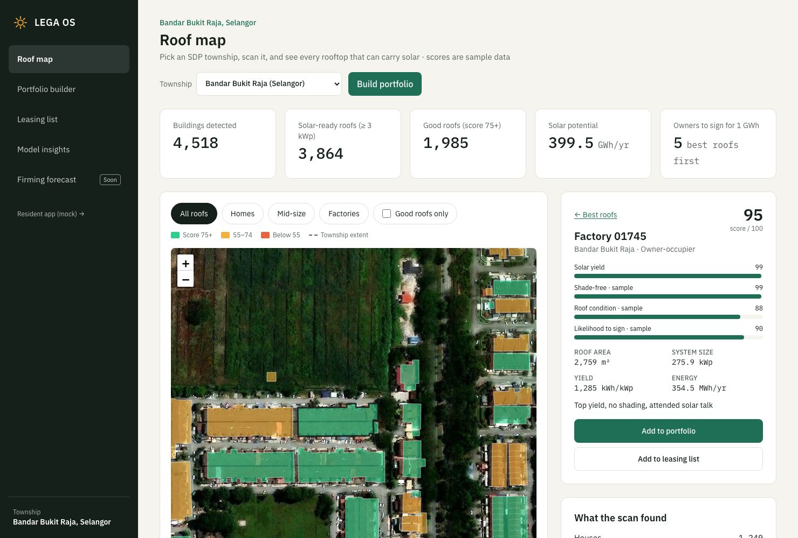
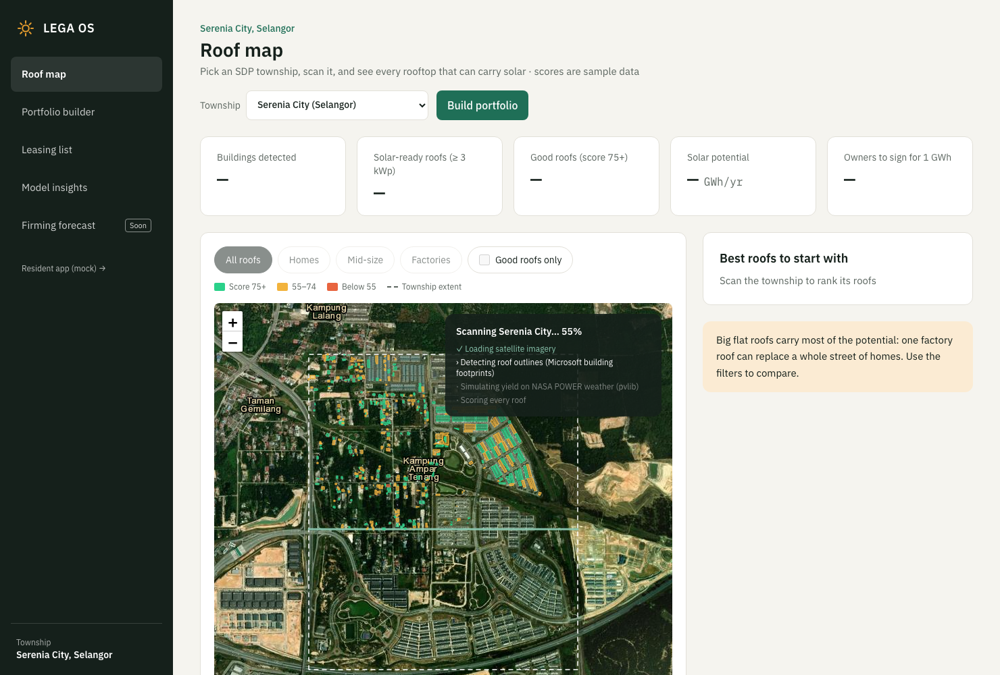
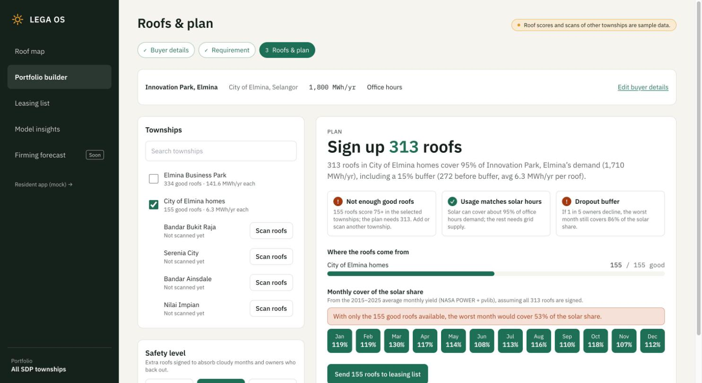
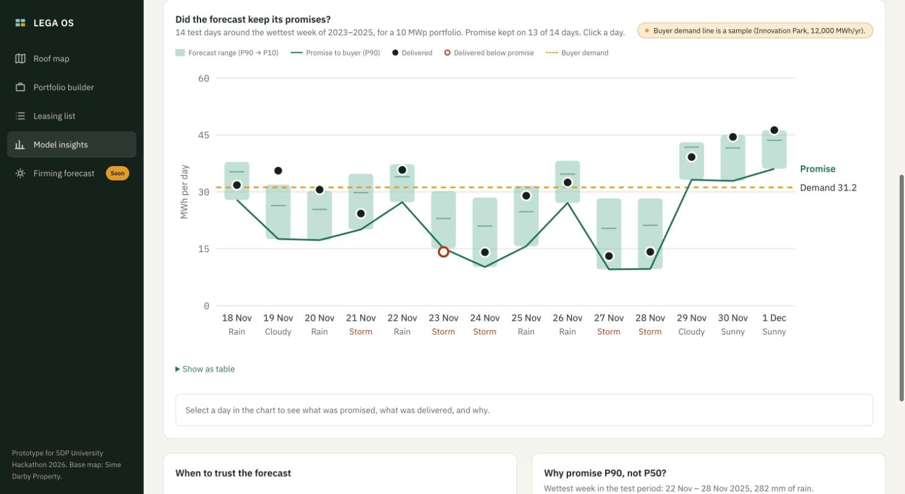
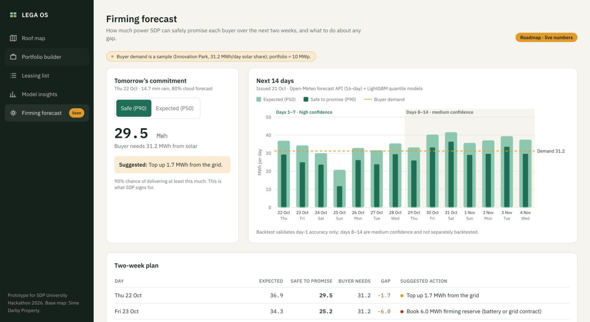
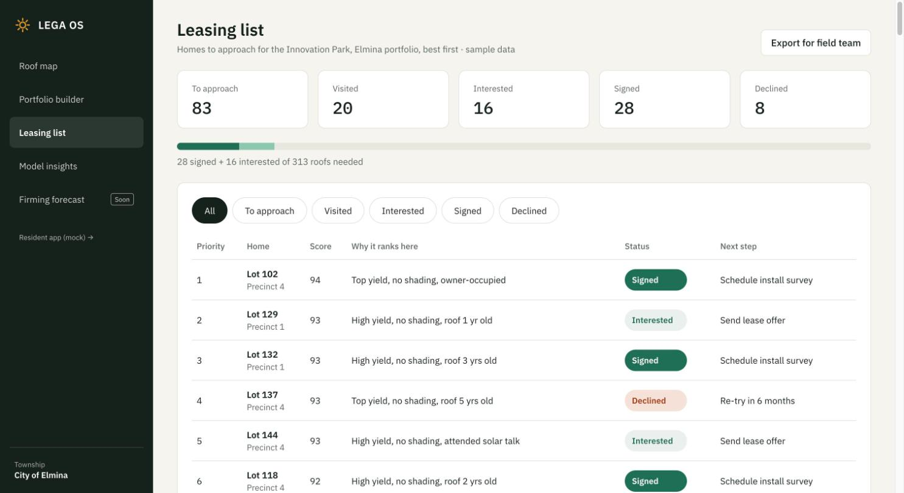
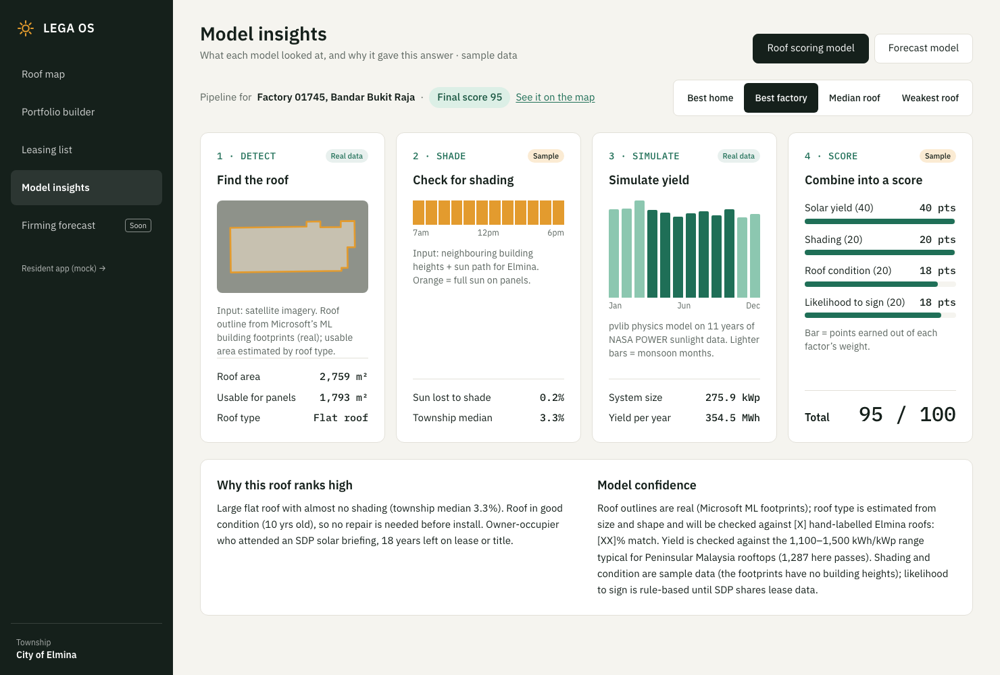

# LEGA OS

**Rooftop solar leasing OS for Sime Darby Property townships.** Prototype for the SDP University Hackathon 2026, *Township of Tomorrow*, Planet theme.

**Live prototype:** https://khairul-kiddie.github.io/lega-os/

SDP leases roofs in its townships, puts solar panels on them, and sells the power to nearby business buyers. The roofs are factories in Elmina Business Park and homes in City of Elmina. LEGA OS answers three questions:

1. **Which roofs should SDP lease?** Every roof gets a 0–100 score.
2. **Which group of roofs covers a buyer's demand?** The portfolio builder sizes it, with a buffer for owners who back out.
3. **How much can SDP safely promise each day?** A 14-day forecast with a P90 "safe to promise" amount, backtested on years the model never saw.



| | |
|---|---|
|  |  |
|  |  |
|  |  |

---

## What is real and what is sample data

| Part | Status | Source |
|---|---|---|
| Weather 2015–2025 (sunlight, clear-sky sunlight, temperature, humidity, rain, cloud, wind) | **Real** | [NASA POWER](https://power.larc.nasa.gov/) daily API, community RE |
| Solar yield per kWp, monthly profile | **Real (simulated)** | pvlib PVWatts model run on NASA POWER data |
| Archived weather forecasts 2017–2025 | **Real** | [Open-Meteo](https://open-meteo.com/) Historical Forecast API and Previous Runs API |
| Forecast model, backtest, live 14-day forecast | **Real** | LightGBM quantile models, Open-Meteo forecast API |
| Roof outlines and roof areas in 9 SDP townships (17,000+ buildings) | **Real** | [Microsoft Global ML Building Footprints](https://github.com/microsoft/GlobalMLBuildingFootprints), Malaysia, 2026-02 release (ODbL) |
| Satellite imagery under the roofs | **Real** | Esri World Imagery tiles (with attribution) |
| Township extents | Real / approximate | OpenStreetMap boundaries via Nominatim. Ara Damansara, Putra Heights and Nilai Impian use a ~2.4 km box around the geocoded centre |
| Yield per township | **Real (simulated)** | pvlib on each township's own NASA POWER cell (1,284–1,320 kWh/kWp/yr) |
| Roof type (house / terrace row / mid-size / factory), usable panel area | Estimated | Size-and-shape rule on the real footprint |
| Shading, roof condition, owner type, likelihood to sign | **Sample** | Fixed seed per roof. The footprints have no building heights, so shading can't be computed yet |
| Elmina Business Park master-plan zones | Hand-placed + **sample** | `pipeline/data/zones.json` on the SDP master plan; planned buildings not yet in the imagery |
| Buyers: Innovation Park (1,800 MWh/yr, office hours), Elmina Lakeside Mall (2,400 MWh/yr, mall hours) | **Sample** | Example buyers, not real contracts |
| Leasing pipeline statuses (signed / interested / …) | **Sample** | Seeded on first visit with the best City of Elmina roofs for the Innovation Park plan; editable |
| Roof facing, usable panel area, sun lost to shade | **Sample** | Derived from the synthetic roof attributes |
| Usage pattern shares (office 95%, mall 70%, 24h 45%) | Placeholder | Replace with metered load profiles |
| Resident app mock (lease income, panel status, street card) | Placeholder | Shown as `[X]`; its 7-day bars scale the live forecast to a 5.3 kWp home |

Every screen that shows sample numbers carries a "sample data" note.

## Township scan

On the Roof map, pick any of nine SDP townships and press **Scan**:
- City of Elmina, Elmina Business Park, Bandar Bukit Raja, Serenia City, Ara Damansara, Putra Heights (Selangor)
- Nilai Impian, Bandar Ainsdale (Negeri Sembilan)
- Bandar Universiti Pagoh (Johor)

The scan sweeps the satellite view and reveals every building found there. Each building gets:
- its roof area (from the real footprint)
- a usable panel area and kWp
- yield simulated on that township's own NASA POWER weather
- a score

Roofs under 3 kWp are dropped as not worth a lease.

The work is precomputed by `python -m lega.townships`; the animation replays it, so the demo works offline. In production the same steps would run on demand, with fresh imagery, a roof-segmentation model and LiDAR for shading.

| Township | Buildings detected | Solar-ready roofs | Good roofs (75+) | Potential, GWh/yr |
|---|---|---|---|---|
| City of Elmina | 5,401 | 4,697 | 2,344 | 170.1 |
| Elmina Business Park | 296 | 242 | 127 | 10.4 |
| Bandar Bukit Raja | 4,518 | 3,864 | 1,985 | 399.5 |
| Serenia City | 632 | 494 | 251 | 17.2 |
| Ara Damansara | 1,423 | 1,259 | 666 | 133.7 |
| Putra Heights | 1,876 | 1,566 | 774 | 86.5 |
| Nilai Impian | 1,771 | 1,518 | 775 | 90.9 |
| Bandar Ainsdale | 390 | 320 | 170 | 28.6 |
| Bandar Universiti Pagoh | 749 | 628 | 315 | 40.6 |

**Caveats:**
- The footprints reflect the age of the satellite imagery, so recent construction may be missing. For example, Elmina Business Park shows 296 buildings, while its master plan has many more planned. The app keeps the master plan as a second view for that township.
- Potential assumes every solar-ready roof is leased.
- Factory roofs dominate the totals. Bukit Raja's largest warehouse roof alone is about 46,000 m².

## Results

### Solar yield (sanity check passed)
Site: City of Elmina, 3.1992 N, 101.5006 E (Wikipedia). The system is fixed-tilt at 10°, facing south, with 14% losses, simulated in pvlib with PVWatts.

- **Annual specific yield: 1,287 kWh/kWp/yr.** The 2015–2025 average; individual years range from 1,255 to 1,349.
- This is inside the 1,100–1,500 kWh/kWp/yr range typical for Peninsular Malaysia rooftops. The pipeline checks this automatically and a pytest test enforces it.
- NASA POWER gives daily totals, so each day is split into hours using pvlib's clear-sky curve scaled to that day's measured sunlight.

### Forecast backtest
The model predicts daily energy for the Innovation Park sample portfolio: 1,800 MWh/yr × 95% office-hours share + 15% buffer at 1,287 kWh/kWp/yr ≈ **1.53 MWp**. The buyer's solar share is 4.7 MWh/day. The model itself predicts kWh per kWp, so the hit rates and errors below don't depend on portfolio size.

- **Training data:** archived Open-Meteo forecasts from 2017-01-02 to 2022-12-31. The archive starts in 2017, so training covers 2017–2022 rather than the 2015–2022 in the brief.
- **Test data:** 2023-01-01 to 2025-12-31, never seen in training.
- **"Actual" output:** the pvlib simulation of NASA POWER satellite sunlight, not metered output.

| | P90 promise met (target ≈ 90%) | Average error of P50 |
|---|---|---|
| Test 2023–2025, archived forecast inputs | **92.6%** | **11.0%** |
| Same, before P90 calibration | 80.2% | 11.0% |
| **True day-ahead check**, 2024-01-20 → 2025-12-31 (712 days) | **86.1%** | 13.8% |
| Baseline: monthly average, no forecast | – | 15.8% |

- **Wettest week in the test period** (22–28 Nov 2025, 282 mm of rain): promising P50 every day would have left SDP **4.9 MWh short** on that 1.53 MWp portfolio, roughly a whole day's demand. Promising P90 left it **0.1 MWh short**.
- **Error by weather:** sunny days 5.4%, cloudy 7.1%, rain 12.5%, storm 34.4%. The app shows trust levels from these.

**Honesty notes:**
- Open-Meteo builds its Historical Forecast archive from the first hours of each forecast run, so those inputs behave like same-day forecasts and flatter accuracy.
- We therefore re-scored 2024–2025 with *true* one-day-ahead forecasts from the Previous Runs API. That is the 86.1% row. In production SDP should widen the buffer slightly, or recalibrate on day-ahead data.
- P90 is calibrated with a conformal shift learned on 2022: the model is trained on 2017–2021 and checked against 2022. Uncalibrated quantile regression met its P90 on only 68% of 2022 days.
- Days 2–14 of the live forecast are not separately backtested and are labelled with lower confidence.

## How it works

```
lega-os/
  pipeline/                 Python: download → simulate → score → train → backtest → JSON
    lega/config.py          site coordinates and system settings (single source of truth)
    lega/nasa_power.py      NASA POWER daily download (cached in data/raw/)
    lega/simulate.py        pvlib yield simulation → yield.json
    lega/townships.py       township scans: footprints → solar-ready roofs → townships/*.json
    lega/roofs.py           master-plan zone roofs for Elmina Business Park → roofs.json (sample)
    lega/forecast.py        LightGBM quantile models and backtest → forecast_backtest.json
    lega/live.py            Open-Meteo 16-day forecast → forecast_live.json (cached fallback)
    lega/formulas.py        portfolio formulas (Python reference)
    data/raw/               cached API responses, so the pipeline runs offline
    models/quantile.joblib  trained models
    tests/                  pytest
  shared/formula_cases.json shared test cases for the Python and TypeScript formulas
  web/                      React + TypeScript + Vite + Tailwind static site
    src/lib/formulas.ts     the same formulas in TypeScript (vitest against the shared cases)
    public/data/            JSON from the pipeline: ≈ 400 KB core + 3.7 MB of township scans,
                            each township loaded only when it is opened (≈ 0.1–1.2 MB, gzip ≈ 25%)
```

- **Heavy work runs offline.** The web app is a static site, so there is no server to fail during judging.
- **The browser does the interactive maths** (portfolio sizing, dropout stress test). It uses the same formulas as the Python version, and both are tested against `shared/formula_cases.json`.
- **A GitHub Action refreshes the live forecast** every morning at 06:30 MYT and redeploys the site (`.github/workflows/refresh-forecast.yml`).

### Run it

```bash
# pipeline (Python 3.11)
cd pipeline
python -m venv .venv && source .venv/bin/activate
pip install -r requirements.txt
python -m lega          # full pipeline; uses cached downloads in data/raw/
python -m lega.live     # refresh just the live 14-day forecast
pytest -q

# web app
cd web
npm install
npm run dev             # http://localhost:5173
npm test                # vitest (shared formula cases)
npm run build
```

### Formulas
These are the formulas from the brief, implemented identically in `pipeline/lega/formulas.py` and `web/src/lib/formulas.ts`:

```
need_yr        = demand × (12 if unit == "month" else 1)
solar_need     = need_yr × pattern_share
roofs_base     = ceil(solar_need / avg_mwh_per_roof)
roofs_needed   = round(roofs_base × (1 + buffer))         # buffer 0 / 0.15 / 0.25
month_cover[m] = supply[m] / (solar_need / 12)
dropout_cover  = min(month_cover) × (1 − 0.20)
enough_roofs   = sum(good_roofs in selected townships) ≥ roofs_needed
```

**Clarifications and changes:**
- **When the selected townships can't supply `roofs_needed`**, the plan flags it. It also shows the worst-month cover the available good roofs would actually reach, and only sends those roofs to the leasing list.
- **`avg_mwh_per_roof`** is the average annual MWh of *good* roofs (score ≥ 75) in the selected townships, weighted by how many each township has. These are the roofs SDP would actually sign.
- **`supply[m]`** = `roofs_needed × avg_mwh_per_roof × monthly_share[m]`. Here `monthly_share` is each month's share of annual yield from the 2015–2025 simulation.
- **`round`** uses half-up rounding, like JavaScript's `Math.round`. Python's built-in `round()` uses banker's rounding, so the Python code uses `floor(x + 0.5)`.
- **Roof score** = 40% yield + 20% shading + 20% roof condition + 20% likelihood to sign.
  - The yield part maps the roof's simulated yield to 0–100, with the site's best case as 100.
  - Likelihood to sign is rule-based: owner type, years left on the lease or title, whether the roof needs repair, and whether the owner attended an SDP solar briefing.
- **Weather classes** use the clearness index (NASA sunlight ÷ clear-sky sunlight) and rainfall:
  - sunny: clearness ≥ 0.80
  - cloudy: 0.65–0.80
  - rain: clearness < 0.65 or rain ≥ 10 mm
  - storm: clearness < 0.50 or rain ≥ 30 mm

## Production architecture (not built in this prototype)

- **API:** FastAPI service with PostGIS. It stores roof polygons, scores, owners and lease status, and serves the portfolio and leasing workflows to several users.
- **Roof detection:** segmentation on satellite or aerial imagery replaces the hand-placed zones and sample roof areas. LiDAR or a 3D city model replaces synthetic shading.
- **Scheduled jobs:**
  - a nightly forecast run (Open-Meteo commercial plan or a national weather feed)
  - weekly retraining on metered inverter output, once installations are live
  - recalibrating P90 on day-ahead data
- **Live scans:** run detection on the latest imagery for any township polygon, instead of the precomputed footprints.
- **CRM integration:** the leasing list feeds real outreach results back in, so likelihood-to-sign can be refitted as a model.

## Data sources and licences

- **NASA POWER:** Prediction Of Worldwide Energy Resources, NASA Langley Research Center. Free and open.
- **Open-Meteo:** forecast, Historical Forecast and Previous Runs APIs. Free for non-commercial use under CC BY 4.0. **A commercial deployment needs a paid Open-Meteo plan.**
- **pvlib:** open-source PV modelling library (BSD-3).
- **Microsoft Global ML Building Footprints:** Open Database License (ODbL). The derived township files keep that licence.
- **Esri World Imagery:** © Esri, Maxar, Earthstar Geographics. Tiles are used with attribution for this non-commercial prototype; a commercial deployment needs an Esri (ArcGIS) licence or another imagery provider.
- **OpenStreetMap / Nominatim:** township extents and place labels, © OpenStreetMap contributors (ODbL).
- **Base map:** Elmina Business Park master plan, © Sime Darby Property. Used for the hackathon prototype only.

No API keys are used or stored in this repository.
