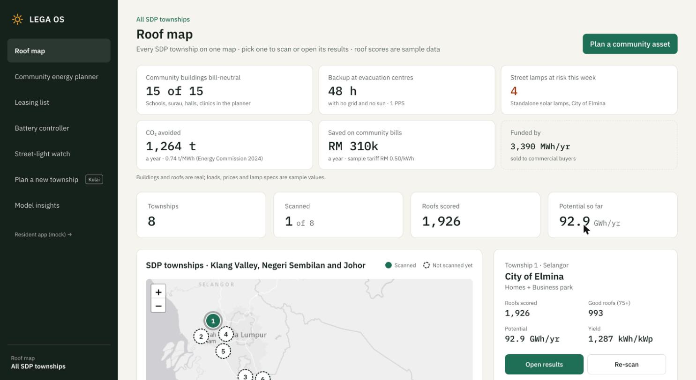
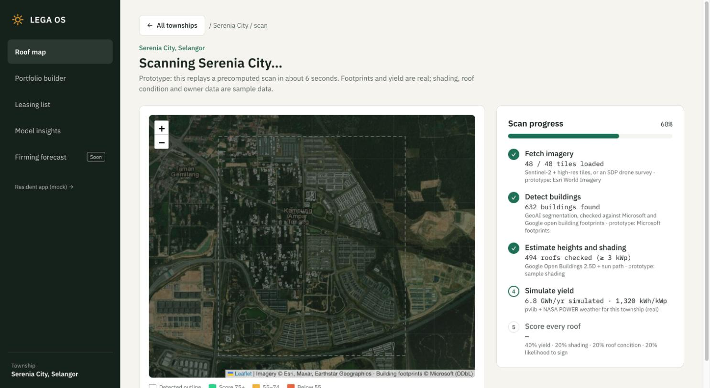
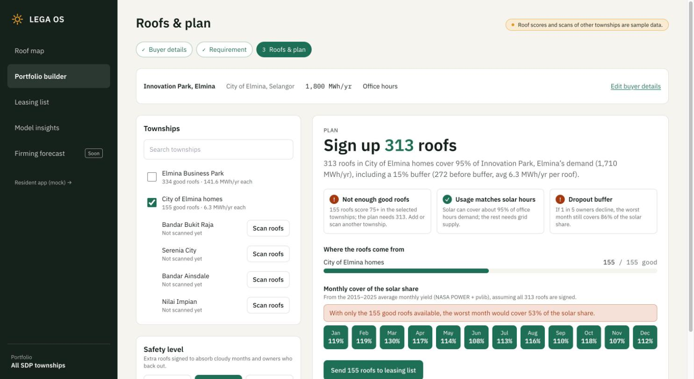
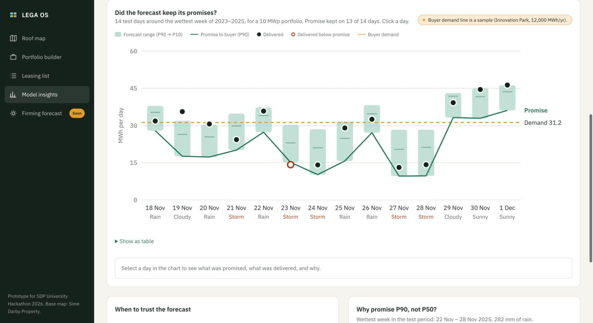
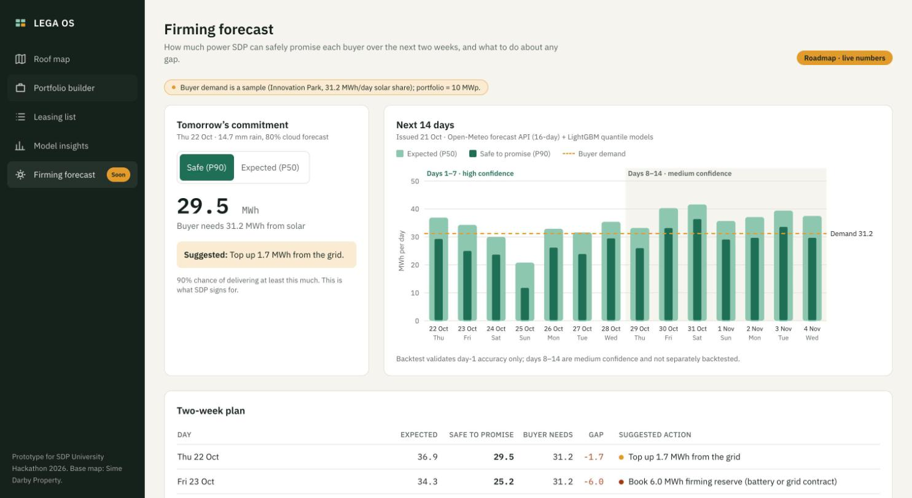
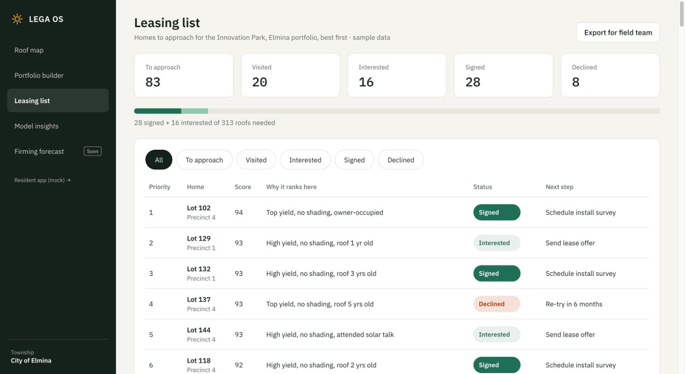
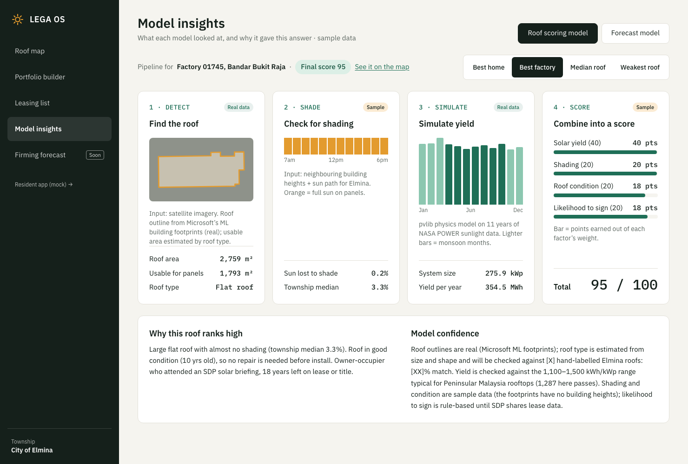

# LEGA OS

**Community solar OS for Sime Darby Property townships.** Prototype for the SDP University Hackathon 2026, *Township of Tomorrow*, Planet theme.

**Live prototype:** https://khairul-kiddie.github.io/lega-os/

**Community-first, commercially funded.** SDP puts solar and batteries on the buildings its townships depend on (schools, surau, community halls and evacuation centres, guardhouses, clinics) and keeps every street lamp lit. Power left over is sold to local businesses, and that margin pays for the batteries and upkeep. LEGA OS answers five questions:

1. **Which roofs?** Every roof in 9 SDP townships, from satellite footprints, gets a 0–100 score.
2. **What does each community building need?** The **Community energy planner** sizes solar, battery and leased roofs for each building, checks it against the wettest week in 11 years, and ranks buildings by community need rather than revenue.
3. **Will it stay on when the grid fails?** The **Battery controller** runs the next 72 hours of weather through each SDP-owned battery, tops up before storms, and simulates a grid outage.
4. **Will the street lamps go dark?** **Street-light watch** runs the 7-day forecast through every standalone solar lamp and plans the maintenance round.
5. **How should a new township be built?** **Plan a new township** (Kulai) shows which design choices actually change rooftop solar, before anything is built.

| Township | Community buildings powered | Solar street lamps | CO₂ avoided, t/yr | Surplus for businesses, GWh/yr |
|---|---|---|---|---|
| City of Elmina | 14 of 14 | 4,131 | 1,259 | 48.9 |
| Elmina Business Park | none mapped | 238 | 39 | 5.2 |
| Bandar Bukit Raja | 7 of 7 | 4,222 | 2,776 | 62.9 |
| Serenia City | none mapped | 943 | 162 | 6.7 |
| Ara Damansara | 23 of 23 | 2,146 | 4,825 | 61.2 |
| Putra Heights | 16 of 16 | 3,372 | 1,416 | 48.4 |
| Nilai Impian | 5 of 5 | 2,821 | 967 | 45.2 |
| Bandar Ainsdale | none mapped | 1,180 | 242 | 4.3 |
| Bandar Universiti Pagoh | 15 of 17 | 650 | 9,915 | 10.6 |

Lamps are estimated from the road network and modelled as standalone solar lamps. No lamp would have gone dark on any of the 4,018 nights from 2015 to 2025. CO₂ is calculated at 0.740 t/MWh, the Energy Commission's provisional 2024 grid emission factor for Peninsular Malaysia.

## v2: community-first

### What the mentors told us
1. **Give back to the community.** SDP cares less about selling power to data centres and more about schools, surau, community halls, guardhouses, evacuation centres (PPS) and street lights.
2. **Own the energy ecosystem.** SDP wants its own batteries and direct supply to local loads, not to depend on TNB for everything.
3. **Plan Kulai for solar.** SDP's new Kulai township (Johor, about 557 acres, first phase 2028) needs help planning residential sites for solar.

### What changed

| Screen | What it does |
|---|---|
| **Roof map** | Now opens with community headline numbers: buildings bill-neutral, backup hours at evacuation centres, lamps at risk this week, CO₂ avoided, community bills saved. Commercial MWh sits in a smaller "Funded by" tile |
| **Community energy planner** (was the portfolio builder) | Asset → goal → plan. Asset types with sample 24-hour load profiles; ownership and criticality; goals *Cut the bills*, *Stay on in an outage* or *Both*. The plan gives kWp, own roof plus leased roofs (CREAM), battery kWh, panels, checks (bill-neutral, wettest week, enough roofs, SDP-owned), a 24-hour solar vs load chart, monthly cover and "Funded by". The list is ranked by a priority score. It starts with City of Elmina's 14 real OpenStreetMap buildings; the **Township map** tab shows them on satellite imagery. Commercial buyers still exist, as the funding source |
| **Battery controller** (replaces the firming forecast) | 72-hour hourly weather (Open-Meteo) through three sample SDP sites. Storm prep, new vs second-life battery, "if the grid fails now", and **Simulate grid outage** |
| **Street-light watch** | 61 sample solar lamps on 5 real Elmina roads; 7-day days-to-dark on the live P90 forecast; reasons; a Thursday maintenance route |
| **Plan a new township (Kulai)** | Sample 416-home layout, real orientation lookup, design levers and "What actually moves the needle" |
| **Model insights → Orientation study (Kulai)** | Tilt × direction heatmap from NASA POWER hourly data |

### Honesty rules the app follows
- **Grid-tied solar switches off in a blackout.** "Stays on in an outage" always means a battery, and the planner only offers it with one.
- **Street lamps run at night, so their solar overlap is zero.** They are modelled as standalone solar lamps with their own panel and battery, and never take rooftops.
- **Near the equator, direction barely matters.** Real hourly data for Kulai: turning one roof face changes its yield by up to 4.1% at 20° tilt (east faces do slightly best), and turning a whole gable house changes its total by about 0.1%. Pitch matters more: 15° makes about 6% more than 30°, and a hip roof has about a third less usable area than a gable.
- **SDP owns what is behind the meter on its own property.** Power from a leased roof to another building still flows over TNB's wires. The app never says "replace TNB".

### Real vs sample (v2)

| Part | Status |
|---|---|
| Community buildings (names, locations), roads | **Real**, OpenStreetMap |
| Solar shape, yield, P90 wettest week | **Real**, NASA POWER 2015–2025 + pvlib, per township |
| Kulai orientation lookup | **Real**, NASA POWER hourly 2020–2024 (GHI, DNI, DHI) + pvlib Perez, 14% losses |
| 72-hour weather for the battery controller | **Real**, Open-Meteo hourly forecast, refreshed each morning; the storm drill adds sample heavy rain in hours 30–50 |
| Load profiles, people served, flood zones, tariffs and battery prices | **Sample** (`web/public/data/load_profiles.json`) |
| Battery sites (PPS 60 kWp / 200 kWh, surau 20 / 60, guardhouse 5 / 15) | **Sample** |
| Street-lamp specs, battery health, tree shade, charge | **Sample**, fixed seed |
| Kulai layout, house loads, retrofit cost | **Sample**, fixed seed. Replace with SDP's Kulai masterplan (CAD/GIS) |

### Formulas (TypeScript and Python, tested against the same cases)

Community energy planner (`web/src/lib/planner.ts`, `pipeline/lega/planner.py`, `shared/planner_cases.json`):
```
annual_load_kWh  = sum(profile_kW[0..23]) × 365 × scale        # scale from the asset's yearly kWh
kwp_bill         = annual_load_kWh / specific_yield
night_kWh_day    = sum(profile_kW[h] × scale for h where solar_shape[h] < 0.05)
critical_kW      = mean(emergency profile) for halls/PPS, else mean(normal profile), × scale
kwp              = kwp_bill (bills) · critical_kW × 24 × 365 / specific_yield (outage) · the larger (both)
battery_kWh      = max(night_kWh_day, critical_kW × backup_hours) / (0.9 DoD × 0.95 efficiency)   # outage goals only
wettest_week_ok  = kwp × p90_wettest_week_kWh_per_kWp_day × 7 + battery_kWh × 0.9 × 0.95 ≥ critical_kW × 24 × 7
                   else "Backup lasts ≈ N hours in the wettest week", plus the extra kWp that would pass
p90_wettest_week = each year's darkest 7 days; the level 90% of years beat
leased_roofs     = ceil((kwp − own_roof_kWp) / average good roof kWp left in the township)
priority         = 40% criticality + 25% people served + 20% flood-risk zone + 15% current bill
funded_by_MWh    = battery_kWh × RM/kWh ÷ (RM 0.08 margin × 1000 × 10 years)
```

Battery controller (`web/src/lib/battery.ts`, `pipeline/lega/battery.py`, `shared/battery_cases.json`), hourly:
```
reserve = 1.00 if rain > 10 mm/h (or a storm flag) within the next 24 h, else 0.30
solar → load; surplus → battery (95% in); the rest → export
storm prep: top the battery up to the reserve, from the grid if needed
deficit → battery down to the reserve (95% out), then grid import
outage: no import or export, the building drops to its critical load, the battery can go to 0; unmet load = dark
usable capacity = nominal × state of health (1.0 new, 0.78 second-life)
```

Street-light watch (`web/src/lib/streetlights.ts`, `pipeline/lega/streetlights.py`, `shared/streetlight_cases.json`), daily:
```
night_Wh   = LED_W × (8 h + 4 h × 50% dimmed, 1–5 am)
charge     = min(battery_Wh × health, charge + panel_Wp × P90 kWh/kWp × shade × 0.85) − night_Wh
at risk    = the first morning charge < 10% of usable capacity, within 7 days
```

Kulai (`web/src/lib/kulai.ts`):
```
faces          = street rotation + {0°, 180°} gable · {0, 90, 180, 270}° hip · 180° flat (5° tilt)
yield_per_kWp  = bilinear lookup(tilt, azimuth), averaged over the faces
kWp            = footprint_m² × usable share (gable 0.45, hip 0.30, flat 0.60) × 0.2 kWp/m²
shading_loss   = 20% (10% one plot further) if a neighbour ≥ 3 m taller is within 8 m east or west (sample rule)
annual_kWh     = kWp × yield_per_kWp × (1 − shading_loss)
bill_neutral   = annual_kWh ≥ terrace 4,800 · semi-D 7,200 · shophouse 9,000 kWh
```



| | |
|---|---|
|  |  |
|  |  |
|  |  |

---

## What is real and what is sample data

| Part | Status | Source |
|---|---|---|
| Weather 2015–2025 (sunlight, clear-sky sunlight, temperature, humidity, rain, cloud, wind) | **Real** | [NASA POWER](https://power.larc.nasa.gov/) daily API, community RE |
| Solar yield per kWp, monthly profile | **Real (simulated)** | pvlib PVWatts model run on NASA POWER data |
| Archived weather forecasts 2017–2025 | **Real** | [Open-Meteo](https://open-meteo.com/) Historical Forecast API and Previous Runs API |
| Forecast model, backtest, live 14-day forecast | **Real** | LightGBM quantile models, Open-Meteo forecast API |
| Roof outlines and roof areas in 9 SDP townships (21,900+ buildings) | **Real** | [Overture Maps buildings](https://docs.overturemaps.org/guides/buildings/), release 2026-10-21.0 (ODbL): conflated OpenStreetMap, Google Open Buildings and Microsoft ML footprints. Each roof records which source it came from |
| Satellite imagery under the roofs | **Real** | Esri World Imagery tiles (with attribution) |
| Township outlines | Real / approximate | OpenStreetMap boundary polygons via Nominatim, cached in `pipeline/data/raw/outlines/`. A building counts only if its centre is inside the outline. Ara Damansara has no mapped boundary, so it uses a ~2.4 km box around the geocoded centre |
| Yield per township | **Real (simulated)** | pvlib on each township's own NASA POWER cell (1,284–1,320 kWh/kWp/yr) |
| Roof type (house, terrace row, apartment, commercial, industrial, public, car park) | **Real where mapped** | The building's OpenStreetMap type, carried by Overture, plus building names (e.g. Elmina Lakeside Mall). Untagged buildings get a size rule and neutral labels ("Mid-size building", "Large building"); tanks and utility structures are left out |
| Usable panel area | Estimated | Share of the real footprint by roof type: 45% for pitched house roofs, 55–65% for flat roofs |
| Shading, roof condition, owner type, likelihood to sign | **Sample** | Fixed seed per roof. The footprints have no building heights, so shading can't be computed yet |
| Buyers: Innovation Park (1,800 MWh/yr, office hours), Elmina Lakeside Mall (2,400 MWh/yr, mall hours) | **Sample** | Example buyers, not real contracts |
| Leasing pipeline statuses (signed / interested / …) | **Sample** | Seeded on first visit with the best City of Elmina roofs the community plan doesn't use, for the Innovation Park plan; community and planner roofs are listed first; editable |
| Roof facing, usable panel area, sun lost to shade | **Sample** | Derived from the synthetic roof attributes |
| Community facilities: schools, kindergartens, masjid and surau, temples, halls, clinics, universities | **Real** | OpenStreetMap amenities via the Overpass API (ODbL), clipped to each township outline, cached in `pipeline/data/raw/community/`. Facilities missing from OpenStreetMap are missing here |
| Road network for street lighting | **Real** | OpenStreetMap roads inside the outline (primary to residential) |
| Street lamp count and positions | Estimated | OpenStreetMap maps very few lamps (50 in City of Elmina), so one LED lamp is placed every 30–40 m by road class (40–150 W, 12 h a night with 4 h dimmed), plus park lamps by area. Modelled as standalone solar lamps. Replace with the council's lamp register |
| Energy use per facility type | Placeholder | Typical annual figures (e.g. school 150 MWh, surau 18 MWh, clinic 30 MWh) and daylight shares. Replace with TNB bills or meters |
| Grid emission factor | **Real** | Energy Commission of Malaysia, Grid Emission Factor 2022–2024 (provisional): Peninsular 2024, 0.740 t CO₂/MWh |
| Usage pattern shares (office 95%, mall 70%, 24h 45%) | Placeholder | Replace with metered load profiles |
| Resident app mock (lease income, panel status, street card) | Placeholder | Shown as `[X]`; its 7-day bars scale the live forecast to a 5.3 kWp home |

Every screen that shows sample numbers carries a "sample data" note.

## Roof map and township scan

The Roof map has two levels, both built from satellite data:

1. **All townships** (the default view): one numbered pin per SDP township, green once scanned and dashed white before. Beside the map:
   - the selected township, with **Open results** / **Re-scan**, or its expected building count and **Scan**
   - the list of all townships
   - a **Scan any other area** box, which validates its input; custom areas are a roadmap stub
2. **One township**: every roof on satellite imagery, coloured by score, with filters, the best roofs and a roof panel. City of Elmina has a **Business park | Homes** toggle; both are satellite scans.

The township list is in `pipeline/lega/townships.py` (`TOWNSHIPS`). Locations come from OpenStreetMap and should be **confirmed against SDP's official township list**:
- City of Elmina (homes + Elmina Business Park), Bandar Bukit Raja, Serenia City, Ara Damansara, Putra Heights (Selangor)
- Nilai Impian, Bandar Ainsdale (Negeri Sembilan)
- Bandar Universiti Pagoh (Johor)

**Scan** opens a progress view that replays the township's precomputed scan in about 6 seconds, and the screen says so. Imagery tiles load, building outlines appear in white, then a second pass colours them by score. Five steps show live counters and their data source:

| Step | Production source | Prototype |
|---|---|---|
| Fetch imagery | Sentinel-2 + high-res tiles, or an SDP drone survey | Esri World Imagery |
| Detect buildings | GeoAI segmentation, checked against Microsoft and Google open building footprints | Overture buildings, clipped to the township outline |
| Estimate heights and shading | Google Open Buildings 2.5D + sun path | Sample shading |
| Simulate yield | pvlib + NASA POWER | Same (real) |
| Score every roof | 40/20/20/20 formula | Same |

When it finishes, a summary card offers **View results**, which opens that township (level 2). Each building gets:
- its roof area (from the real footprint)
- a usable panel area and kWp
- yield simulated on that township's own NASA POWER weather
- a score

Roofs under 3 kWp are dropped as not worth a lease.

The work is precomputed by `python -m lega.townships`; the animation replays it, so the demo works offline. In production the same steps would run on demand, with fresh imagery, a roof-segmentation model and LiDAR for shading.

| Township | Buildings detected | Solar-ready roofs | Good roofs (75+) | Potential, GWh/yr |
|---|---|---|---|---|
| City of Elmina (homes) | 2,380 | 1,813 | 935 | 85.7 |
| Elmina Business Park | 200 | 113 | 58 | 7.2 |
| Bandar Bukit Raja | 3,524 | 2,703 | 1,420 | 118.2 |
| Serenia City | 607 | 461 | 242 | 12.5 |
| Ara Damansara (approx. box) | 3,474 | 2,736 | 1,443 | 118.7 |
| Putra Heights | 7,997 | 7,193 | 3,694 | 92.8 |
| Nilai Impian | 2,707 | 1,805 | 916 | 75.8 |
| Bandar Ainsdale | 361 | 201 | 111 | 7.2 |
| Bandar Universiti Pagoh | 658 | 557 | 309 | 30.8 |

**Caveats:**
- **Why outlines, not boxes.** An earlier version took every building in each township's bounding box. For City of Elmina that pulled in Kampung Kubu Gajah and other neighbouring areas: only 716 of its 4,697 "Elmina" roofs were actually inside Elmina. Scans are now clipped to the OpenStreetMap outline, and a test checks that every roof lies inside it.
- **Why Overture, not Microsoft alone.** Microsoft's footprints come from older imagery and missed most of Elmina's newer housing: 861 buildings inside Elmina's outline, against 2,380 in Overture, which adds OpenStreetMap and Google Open Buildings.
- **Still not complete.** Outlines reflect each source's imagery date, so the newest phases and land under construction may be missing. Elmina Business Park shows 200 buildings; planned or newly built units appear once the building datasets catch up (or, in production, from SDP layouts and drone surveys).
- **Township boundaries are OpenStreetMap's**, not SDP's. If SDP's official City of Elmina boundary includes areas outside the OSM outline, those roofs are not counted. Confirm against SDP's list.
- Potential assumes every solar-ready roof is leased.
- Large flat roofs dominate the totals. Bukit Raja's largest roof inside its outline is an industrial building of about 31,500 m².
- **Why typed labels.** An earlier version called every outline over 1,500 m² a "factory". In City of Elmina, 66 of those 98 "factories" were terrace blocks that OpenStreetMap draws as one outline, plus the Lakeside Mall, a school, a car park and a water tank. Labels now follow the mapped building type; City of Elmina has 21 industrial buildings, mostly in its south-east corner.

## Community energy plan

`python -m lega.community` builds the plan for each township; the planner's **Township map** tab shows it on satellite imagery.

1. **Facilities.** Every school, kindergarten, university or college, masjid, surau, temple, community hall, clinic and public service mapped in OpenStreetMap inside the township outline. A place mapped twice (as a point and as an area) is counted once.
2. **Own roof first.** A facility mapped as an area uses the roofs inside its grounds, taking only as many as it needs; a campus keeps the rest for others. A facility mapped as a point uses the roof under it.
3. **Neighbours fill the gap.** The target is the **cloudiest month**, with the after-dark share of the load going through a battery (90% round trip). If the facility's own roof falls short, the nearest good roofs (score 75+) within 500 m are added. Roofs are picked "best fit": the smallest roof that covers what's left, so a 30,000 m² factory isn't spent on one surau.
4. **Street lamps.** Lamps run at night, so each is a **standalone solar lamp** with its own panel and battery, dimmed to 50% from 1 am to 5 am; lamps take no roofs. Lamps are grouped into ~700 m cells for the map. Each lamp's panel is sized to 1.4× its average nightly need, and its battery is the smallest that, replayed day by day through 2015–2025 on the township's own NASA POWER weather, never lets a night go dark and keeps a 20% reserve (City of Elmina: about 230–520 Wp and 2.2–4.9 kWh per pole). With a battery that holds only one night, the worst group in City of Elmina would have gone dark on 255 nights.
5. **Surplus.** Good roofs the plan doesn't use, plus what facility roofs make beyond their needs, go to business buyers. The pipeline writes `community_reserved` into the township index, so commercial plans can't use community roofs. The leasing list puts community roofs first.

**Caveats:**
- Energy use per facility is a typical figure, not metered.
- Lamp counts are estimates.
- Facilities that OpenStreetMap hasn't mapped are missing: Serenia City and Bandar Ainsdale show none.
- A building on its own roof is behind the meter. Power from a leased neighbour roof to a school reaches it over TNB's wires (for example under NEM or CRESS); SDP owns the panels and batteries on its own property. The route needs confirming with the Energy Commission and TNB.

## Results

### Solar yield (sanity check passed)
Site: City of Elmina, 3.1992 N, 101.5006 E (Wikipedia). The system is fixed-tilt at 10°, facing south, with 14% losses, simulated in pvlib with PVWatts.

- **Annual specific yield: 1,287 kWh/kWp/yr.** The 2015–2025 average; individual years range from 1,255 to 1,349.
- This is inside the 1,100–1,500 kWh/kWp/yr range typical for Peninsular Malaysia rooftops. The pipeline checks this automatically and a pytest test enforces it.
- NASA POWER gives daily totals, so each day is split into hours using pvlib's clear-sky curve scaled to that day's measured sunlight.

### Forecast backtest
The model predicts daily energy for the Innovation Park sample portfolio: 1,800 MWh/yr × 95% office-hours share + 15% buffer at 1,287 kWh/kWp/yr ≈ **1.53 MWp**. The buyer's solar share is 4.7 MWh/day. The model itself predicts kWh per kWp, so the hit rates and errors below don't depend on portfolio size.

On the **Surplus forecast** screen (`/firming?view=buyers`, linked from commercial buyers) you pick a commercial buyer. The forecast (kWh/kWp, written by `lega.live`) is rescaled to that buyer's plan: portfolio kWp = roofs signed × average MWh per roof ÷ Elmina's yield, and the buyer's need = their solar share ÷ 365. The wettest-week shortfalls are rescaled the same way. Weather is still Elmina's forecast for every township.

- **Training data:** archived Open-Meteo forecasts from 2017-01-02 to 2022-12-31. The archive starts in 2017, so training covers 2017–2022 rather than the 2015–2022 in the brief.
- **Test data:** 2023-01-01 to 2025-12-31, never seen in training.
- **"Actual" output:** the pvlib simulation of NASA POWER satellite sunlight, not metered output.

| | P90 promise met (target ≈ 90%) | Average error of P50 |
|---|---|---|
| Test 2023–2025, archived forecast inputs | **92.6%** | **11.0%** |
| Same, before P90 calibration | 80.2% | 11.0% |
| **True day-ahead check**, 2024-01-20 → 2025-12-31 (712 days) | **86.1%** | 13.8% |
| Baseline: monthly average, no forecast | – | 15.8% |

- **Wettest week in the test period** (22–28 Nov 2025, 282 mm of rain): promising P50 every day would have left SDP **4.9 MWh short** on that 1.53 MWp portfolio, roughly a whole day's demand. Promising P90 left it **0.1 MWh short**.
- **Error by weather:** sunny days 5.4%, cloudy 7.1%, rain 12.5%, storm 34.4%. The app shows trust levels from these.

**Honesty notes:**
- Open-Meteo builds its Historical Forecast archive from the first hours of each forecast run, so those inputs behave like same-day forecasts and flatter accuracy.
- We therefore re-scored 2024–2025 with *true* one-day-ahead forecasts from the Previous Runs API. That is the 86.1% row. In production SDP should widen the buffer slightly, or recalibrate on day-ahead data.
- P90 is calibrated with a conformal shift learned on 2022: the model is trained on 2017–2021 and checked against 2022. Uncalibrated quantile regression met its P90 on only 68% of 2022 days.
- Days 2–14 of the live forecast are not separately backtested and are labelled with lower confidence.

## How it works

```
lega-os/
  pipeline/                 Python: download → simulate → score → train → backtest → JSON
    lega/config.py          site coordinates and system settings (single source of truth)
    lega/nasa_power.py      NASA POWER daily download (cached in data/raw/)
    lega/simulate.py        pvlib yield simulation → yield.json
    lega/townships.py       township scans: footprints → solar-ready roofs → townships/*.json
    lega/community.py       community plan: OSM facilities + roads → roofs, solar lamps → community/*.json
    lega/planner.py         planner load profiles, wettest week, sizing formulas → load_profiles.json
    lega/battery.py         72-hour weather + dispatch rules → battery_72h.json
    lega/streetlights.py    sample solar-lamp fleet on real roads + days-to-dark → streetlights.json
    lega/kulai_orientation.py  Kulai tilt × azimuth lookup (NASA POWER hourly + Perez) → orientation_lookup.json
    lega/kulai.py           sample Kulai layout + Kulai wettest week → kulai_layout.json
    lega/scoring.py         roof score rules (40/20/20/20, likelihood to sign, "why" phrase)
    lega/forecast.py        LightGBM quantile models and backtest → forecast_backtest.json
    lega/live.py            Open-Meteo 16-day forecast → forecast_live.json (cached fallback)
    lega/formulas.py        portfolio formulas (Python reference)
    data/raw/               cached API responses, so the pipeline runs offline
    models/quantile.joblib  trained models
    tests/                  pytest
  shared/*.json             shared test cases for the Python and TypeScript formulas (portfolio, planner,
                            battery dispatch, street lamps)
  web/                      React + TypeScript + Vite + Tailwind static site
    src/lib/formulas.ts     the same formulas in TypeScript (vitest against the shared cases)
    public/data/            JSON from the pipeline: 2.9 MB in all (≈ 300 KB core + 2.6 MB of township
                            scans, each loaded only when opened, 0.02–1.0 MB). Repeated text is stored
                            once per file and unpacked in the browser (townships.py pack / townships.ts)
```

- **Heavy work runs offline.** The web app is a static site, so there is no server to fail during judging.
- **The browser does the interactive maths** (portfolio sizing, dropout stress test). It uses the same formulas as the Python version, and both are tested against `shared/formula_cases.json`.
- **A GitHub Action refreshes the live 14-day forecast and the 72-hour battery weather** every morning at 06:30 MYT and redeploys the site (`.github/workflows/refresh-forecast.yml`).

### Run it

```bash
# pipeline (Python 3.11)
cd pipeline
python -m venv .venv && source .venv/bin/activate
pip install -r requirements.txt
python -m lega          # full pipeline; uses cached downloads in data/raw/
python -m lega.live     # refresh just the live 14-day forecast
pytest -q

# web app
cd web
npm install
npm run dev             # http://localhost:5173
npm test                # vitest (shared formula cases)
npm run build
```

### Formulas
These are the formulas from the brief, implemented identically in `pipeline/lega/formulas.py` and `web/src/lib/formulas.ts`:

```
need_yr        = demand × (12 if unit == "month" else 1)
solar_need     = need_yr × pattern_share
roofs_base     = ceil(solar_need / avg_mwh_per_roof)
roofs_needed   = round(roofs_base × (1 + buffer))         # buffer 0 / 0.15 / 0.25
month_cover[m] = supply[m] / (solar_need / 12)
dropout_cover  = min(month_cover) × (1 − 0.20)
enough_roofs   = sum(good_roofs in selected townships) ≥ roofs_needed
```

**Clarifications and changes:**
- **When the selected townships can't supply `roofs_needed`**, the plan flags it. It also shows the worst-month cover the available good roofs would actually reach, and only sends those roofs to the leasing list.
- **`avg_mwh_per_roof`** is the average annual MWh of *good* roofs (score ≥ 75) in the selected townships, weighted by how many each township has. These are the roofs SDP would actually sign.
- **`supply[m]`** = `roofs_needed × avg_mwh_per_roof × monthly_share[m]`. Here `monthly_share` is each month's share of annual yield from the 2015–2025 simulation.
- **`round`** uses half-up rounding, like JavaScript's `Math.round`. Python's built-in `round()` uses banker's rounding, so the Python code uses `floor(x + 0.5)`.
- **Roof score** = 40% yield + 20% shading + 20% roof condition + 20% likelihood to sign.
  - The yield part maps the roof's simulated yield to 0–100, with the site's best case as 100.
  - Likelihood to sign is rule-based: owner type, years left on the lease or title, whether the roof needs repair, and whether the owner attended an SDP solar briefing.
- **Weather classes** use the clearness index (NASA sunlight ÷ clear-sky sunlight) and rainfall:
  - sunny: clearness ≥ 0.80
  - cloudy: 0.65–0.80
  - rain: clearness < 0.65 or rain ≥ 10 mm
  - storm: clearness < 0.50 or rain ≥ 30 mm

## Production architecture (not built in this prototype)

- **API:** FastAPI service with PostGIS. It stores roof polygons, scores, owners and lease status, and serves the portfolio and leasing workflows to several users.
- **Roof detection:** segmentation on satellite or aerial imagery adds buildings that the open datasets haven't captured yet. LiDAR or a 3D city model replaces synthetic shading.
- **Scheduled jobs:**
  - a nightly forecast run (Open-Meteo commercial plan or a national weather feed)
  - weekly retraining on metered inverter output, once installations are live
  - recalibrating P90 on day-ahead data
- **Live scans:** run detection on the latest imagery for any township polygon, instead of the precomputed footprints.
- **CRM integration:** the leasing list feeds real outreach results back in, so likelihood-to-sign can be refitted as a model.

## Data sources and licences

- **NASA POWER:** Prediction Of Worldwide Energy Resources, NASA Langley Research Center. Free and open.
- **Open-Meteo:** forecast, Historical Forecast and Previous Runs APIs. Free for non-commercial use under CC BY 4.0. **A commercial deployment needs a paid Open-Meteo plan.**
- **pvlib:** open-source PV modelling library (BSD-3).
- **OpenStreetMap / Overpass API:** community facilities and roads, © OpenStreetMap contributors (ODbL).
- **Energy Commission of Malaysia:** Grid Emission Factor (GEF) in Malaysia 2022–2024 (provisional).
- **Overture Maps buildings:** Open Database License (ODbL); it includes OpenStreetMap (ODbL), Google Open Buildings (CC BY 4.0 / ODbL) and Microsoft ML Building Footprints (ODbL). The derived township files keep the ODbL.
- **Esri World Imagery:** © Esri, Maxar, Earthstar Geographics. Tiles are used with attribution for this non-commercial prototype; a commercial deployment needs an Esri (ArcGIS) licence or another imagery provider.
- **OpenStreetMap / Nominatim:** township extents and place labels, © OpenStreetMap contributors (ODbL).

No API keys are used or stored in this repository.
